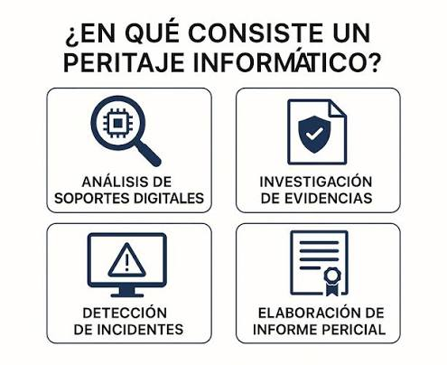
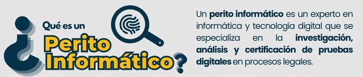
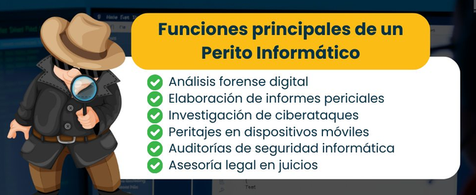
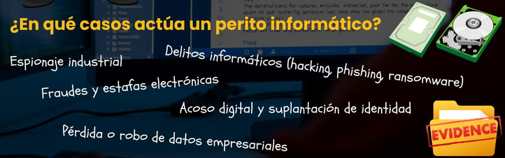

#### Ingeniería de Software

### Unidad XVI

# Introducción al Peritaje
Created by <i class="fab fa-telegram"></i>
[edme88]("https://t.me/edme88")

---
<!-- .slide: style="font-size: 0.60em" -->

## Temario

### Calidad del Software
* Peritaje Informático
* Pericia y Perito
* Peritos
* Proceso pericial
* Quien puede ser perito?

* Peritos en Argentina
* Fuentes
* Herramientas y técnicas

---
### Peritaje Informático
El **peritaje informático** es una actividad técnica que consiste en el análisis, evaluación y presentación de pruebas relacionadas con sistemas informáticos en el marco de un proceso judicial, administrativo o interno. 

Su objetivo es aportar conocimiento especializado para esclarecer hechos donde la tecnología juega un rol central, como fraudes digitales, accesos no autorizados, manipulación de datos o conflictos sobre propiedad intelectual.

----

### Peritaje Informático
El resultado del peritaje se expresa en un informe pericial, que debe ser claro, objetivo, fundamentado y comprensible para personas sin conocimientos técnicos.

----

---
### Pericia y Perito

La **pericia** es el procedimiento técnico en sí, mientras que el **perito** es el profesional encargado de realizarlo. El perito debe actuar con independencia, imparcialidad y competencia, siguiendo metodologías reconocidas y garantizando la integridad de las pruebas.

Los peritos no deciden sobre la causa, sino que aportan elementos técnicos objetivos para ayudar al juez o autoridad competente a tomar decisiones.

---

---
### Clases de Peritos
<!-- .slide: style="font-size: 0.85em" -->
Los peritos pueden clasificarse en distintas categorías según su designación o especialidad:
- **Perito de oficio:** es designado por el juez o tribunal, generalmente mediante sorteo de una lista de profesionales habilitados.
- **Perito oficial:** pertenece a un organismo o institución estatal y realiza tareas periciales en el ámbito de sus competencias.
- **Perito de parte:** es contratado o propuesto por una de las partes para aportar conocimientos técnicos y analizar los resultados de la investigación.
- **Consultor técnico:** especialista designado por una de las partes para asesorarla y participar técnicamente en el proceso, según las reglas procesales aplicables.

---

---

---
### ¿Quién puede ser perito?
Puede ser **perito** cualquier persona con formación técnica especializada y experiencia comprobable en el área a analizar. En algunos países o jurisdicciones, es necesario estar inscripto en un registro oficial de peritos judiciales. Además, debe actuar bajo principios éticos, sin conflicto de intereses, y mantener la confidencialidad de la información tratada.

---
### Peritos en Argentina
En Argentina es necesario estar inscripto oficialmente para actuar como perito judicial y contar con un título habilitante en su especialidad (como informática, ingeniería, etc). Además, deben estar matriculados en el colegio o consejo profesional. También se debe considerar que cada provincia puede contar con otros requisitos.

---

### Principios
<!-- .slide: style="font-size: 0.95em" -->
- **Objetividad:** analizar la evidencia sin favorecer a ninguna de las partes.
- **Imparcialidad:** evitar intereses personales o conflictos que puedan influir en las conclusiones.
- **Integridad:** garantizar que la evidencia no sea modificada o alterada.
- **Trazabilidad:** documentar todas las acciones realizadas sobre la evidencia.
- **Reproducibilidad:** permitir que otro especialista pueda repetir el procedimiento y verificar los resultados.
- **Confidencialidad:** proteger la información obtenida durante el peritaje.

---

### Principios
Un aspecto fundamental es la cadena de custodia, que consiste en documentar quién tuvo contacto con la evidencia, cuándo, dónde y qué procedimientos se realizaron sobre ella.

Esto permite demostrar que la evidencia conservó su integridad desde su obtención hasta su presentación.

---

### Métodos, técnicas y herramientas
- **Métodos:** enfoques generales que orientan la investigación.
- **Técnicas:** procedimientos concretos aplicados para obtener o analizar información.
- **Herramientas:** programas o dispositivos utilizados para ejecutar las técnicas.

---

### Metodología

La **metodología pericial** es el conjunto de procedimientos, criterios y principios técnicos que orientan la investigación para obtener resultados confiables, verificables y reproducibles.

---

### Métodos y Técnicas
<table>
<tr>
<th>Método</th><th>Técnicas asociadas</th>
</tr>
<tr>
<td>Análisis forense de dispositivos</td><td>Adquisición de imágenes, recuperación de archivos y análisis de sistemas de archivos.</td>
</tr>
<tr>
<td>Análisis de redes</td><td>Captura de tráfico, análisis de paquetes y revisión de conexiones.</td>
</tr>
<tr>
<td>Análisis de archivos</td><td>Inspección de metadatos, formatos y fechas de modificación.</td>
</tr>
<tr>
<td>Análisis de registros</td><td>Correlación de eventos, revisión de logs y reconstrucción de actividades.</td>
</tr>
<tr>
<td>Verificación de integridad</td><td>Cálculo y comparación de valores hash.</td>
</tr>
<tr>
<td>Investigación en fuentes abiertas (OSINT)</td><td>Consulta y correlación de información pública.</td>
</tr>
</table>

---
### Fuentes
Durante un peritaje informático se pueden consultar y analizar diversas fuentes de información, tales como:
- Equipos informáticos (PCs, laptops, servidores).
- Dispositivos móviles y almacenamiento externo.
- Registros de red y firewalls.
- Bases de datos, correos electrónicos, logs del sistema.
- Capturas de pantalla, backups y archivos digitales.
- Plataformas en la nube y redes sociales.

Todas estas fuentes deben ser preservadas adecuadamente para no alterar la evidencia.

---

### Fuentes: Clasificación
- **Fuentes físicas:** computadoras, servidores, teléfonos móviles, discos rígidos, pendrives y otros dispositivos.
- **Fuentes lógicas:** archivos, bases de datos, sistemas operativos, registros de eventos y correos electrónicos.
- **Fuentes de red:** tráfico de red, registros de routers, firewalls, servidores DNS y conexiones.
- **Fuentes externas:** servicios en la nube, redes sociales, plataformas digitales y proveedores de servicios.

---
### Proceso pericial
<!-- .slide: style="font-size: 0.85em" -->
El proceso pericial suele seguir una secuencia ordenada para garantizar la validez legal y técnica del análisis:
1. **Designación y aceptación del cargo:** el perito es designado, acepta su responsabilidad y declara posibles conflictos de intereses.
2. **Estudio del caso:** analiza los antecedentes y determina qué cuestiones técnicas debe resolver.
3. **Definición de los puntos de pericia:** identifica las preguntas concretas que debe responder.
4. **Identificación y recolección de evidencias:** localiza los dispositivos y fuentes de información relevantes.
5. **Preservación de la evidencia:** documenta su estado, protege su integridad y establece la cadena de custodia.

----

### Proceso pericial
<!-- .slide: style="font-size: 0.95em" -->
6. **Adquisición de la evidencia:** obtiene copias de trabajo para realizar el análisis, procurando conservar los originales.
7. **Análisis técnico:** aplica los métodos y técnicas correspondientes.
8. **Documentación de resultados:** registra los procedimientos, herramientas, hallazgos y limitaciones.
9. **Elaboración del informe pericial:** presenta las conclusiones y responde los puntos de pericia.
10. **Ratificación y aclaraciones:** explica o fundamenta el informe ante el tribunal cuando sea requerido.

---
### Herramientas
Algunas herramientas empleadas por peritos son:
- **Autopsy y FTK:** análisis forense de dispositivos y archivos.
- **Wireshark:** análisis de tráfico de red.
- **EnCase:** investigación forense digital.
- **Herramientas de cálculo hash:** verificación de integridad de archivos.

---

### Informe pericial informático
Es el documento técnico mediante el cual el perito presenta los resultados de su investigación y responde los puntos de pericia solicitados.

----

### Informe pericial informático: Contenido
<!-- .slide: style="font-size: 0.90em" -->
1. **Identificación:** datos del perito y del expediente o investigación.
2. **Objeto de la pericia:** descripción de lo que se busca determinar.
3. **Puntos de pericia:** preguntas técnicas que deben responderse.
4. **Metodología:** procedimientos y criterios utilizados.
5. **Evidencias analizadas:** descripción de los elementos examinados.
6. **Análisis y resultados:** explicación de las operaciones realizadas y los hallazgos.
7. **Conclusiones:** respuestas claras y fundamentadas a los puntos planteados.

----

### Informe pericial informático: Contenido
El informe debe ser objetivo, comprensible, verificable y estar respaldado por evidencia.

---

### Caso: Investigación de un acceso no autorizado

Una empresa detecta que alguien ingresó a su sistema fuera del horario laboral y modificó información almacenada en una base de datos.

1. ¿Qué tipo de perito debería intervenir?
2. ¿Qué fuentes de información debería analizar?
3. ¿Qué evidencias debería preservar?
4. ¿Qué metodología debería aplicar?
5. ¿Qué técnicas y herramientas podría utilizar?
6. ¿Qué debería incluir en el informe pericial?

<!--
1. ¿Qué tipo de perito debería intervenir?
Debería intervenir un perito informático especializado en informática forense y seguridad informática, con conocimientos en bases de datos, sistemas operativos y redes.

Según el contexto judicial, podría tratarse de un perito oficial, de oficio o de parte.
2. ¿Qué fuentes de información debería analizar?
Las principales fuentes serían:
- Base de datos: registros de modificaciones, eliminación o inserción de información.
- Logs del sistema: registros de inicio de sesión, accesos y actividades realizadas.
- Servidores: registros de conexiones y actividad del sistema operativo.
- Firewall y redes: conexiones entrantes y salientes, direcciones IP y horarios de acceso.
- Equipos informáticos: computadoras utilizadas para acceder al sistema.
- Correos electrónicos: posibles comunicaciones relacionadas con el incidente.
3. ¿Qué evidencias debería preservar?
Debería preservar:
- Los registros de acceso y actividad del sistema.
- Los archivos de logs del servidor y de la base de datos.
- Las copias de seguridad disponibles.
- Las imágenes forenses de los equipos involucrados, cuando corresponda.
- Los registros de red y firewall.
Además, debería documentar la obtención de cada evidencia, calcular sus valores hash para verificar su integridad y mantener una cadena de custodia que permita conocer quién tuvo acceso a ellas y qué procedimientos se realizaron.
4. ¿Qué metodología debería aplicar?
Debería aplicar una metodología de análisis forense digital, respetando los siguientes principios:
- Objetividad: no asumir quién fue responsable antes de analizar las evidencias.
- Integridad: evitar modificar las evidencias originales.
- Trazabilidad: documentar cada procedimiento realizado.
- Reproducibilidad: permitir que otro especialista pueda verificar los resultados.
- Confidencialidad: proteger la información de la empresa.
El análisis debería realizarse sobre copias de trabajo siempre que sea posible, preservando los originales.
5. ¿Qué técnicas y herramientas podría utilizar?
Técnica	Herramienta posible	Objetivo
Análisis de logs	Visores de eventos y herramientas SIEM	Identificar accesos y actividades sospechosas.
Análisis de bases de datos	Herramientas de administración SQL	Identificar modificaciones realizadas.
Análisis de tráfico de red	Wireshark	Examinar conexiones relacionadas con el incidente.
Análisis forense de discos	Autopsy o FTK	Examinar archivos y rastros de actividad.
Verificación de integridad	SHA-256	Comprobar que las evidencias no fueron modificadas.
Análisis de registros de acceso	Herramientas de auditoría	Reconstruir cuándo y desde dónde se accedió.

6. ¿Qué debería incluir en el informe pericial?
El informe debería contener:
1. Identificación: datos del perito y de la investigación.
2. Objeto de la pericia: investigar el acceso no autorizado y las modificaciones realizadas.
3. Evidencias analizadas: servidores, bases de datos, logs y equipos involucrados.
4. Metodología: procedimientos y criterios utilizados.
5. Análisis realizado: descripción de las verificaciones efectuadas.
6. Resultados: hallazgos obtenidos, fechas, horarios y registros relevantes.
7. Conclusiones: respuestas fundamentadas sobre lo que pudo determinarse.
Es importante que el perito distinga entre hechos comprobados, indicios e hipótesis. Por ejemplo, encontrar un acceso desde una dirección IP determinada no demuestra, por sí solo, quién fue la persona que lo realizó.

7. Conclusión general del caso
El peritaje informático permite investigar un incidente tecnológico mediante la recolección, preservación y análisis de evidencias digitales.

El objetivo no es solamente identificar qué ocurrió, sino obtener resultados técnicamente fundamentados que puedan ser verificados y utilizados para esclarecer los hechos.
-->

---
## ¿Dudas, Preguntas, Comentarios?
